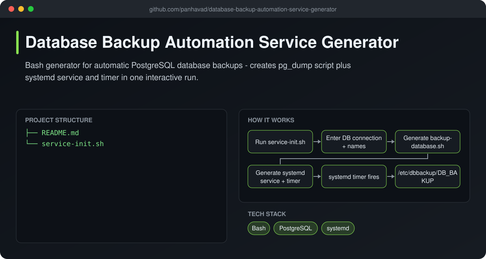
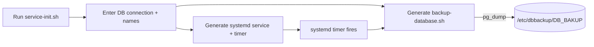

# Database Backup Automation Service Generator

  [](https://github.com/panhavad/database-backup-automation-service-generator/releases/latest)

An interactive **Bash script that sets up automatic PostgreSQL backups** on Linux. Answer a few questions and it generates the `pg_dump` backup script, a **systemd service** and a **systemd timer** - no more hand-writing the same files on every server.



## Features

- Prompts for host, port, user, password and databases
- Backs up multiple databases with compressed `pg_dump`
- Generates `/usr/local/bin/backup-database.sh`
- Creates and enables systemd service + timer
- Timestamped backup files per database

## How it works



## Getting started

```bash
sudo bash service-init.sh
systemctl list-timers | grep backup
```

## Download

Grab the packaged source from the [latest release](https://github.com/panhavad/database-backup-automation-service-generator/releases/latest).

## Tech stack

- Bash
- PostgreSQL
- systemd

## Project structure

```text
database-backup-automation-service-generator/
├── docs/
├── README.md
└── service-init.sh
```

## Original notes

Since there are so many project that using database and need to be backup frequently to avoid lost of data, and to do the auto backup process we need to create service file blah blah blah that could take so much time. And all we do is just same thing from one server to other.
So this script will mainly automate generate everything including service and timer file base on what user want. After this finish there will be also a automation script to automate the auto upload those backup to Google drive too.
